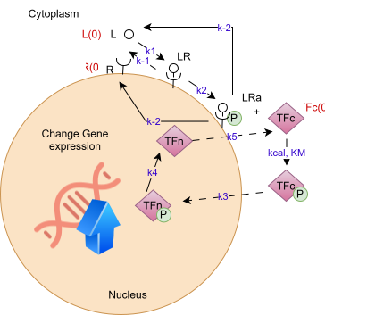

# Modeling Biosystems

This repository contains code, computational models, simulations, and analyses developed as part of the **Modeling Biosystems** course.

## Contents
- Computational models of biological systems
- Simulation scripts
- Data analysis and visualization
- Course assignments and group projects

## Collaboration
This repository is shared among course collaborators. Contributions and improvements can be submitted through GitHub.

## Pathway diagram

[Editable diagram](pathway_diagram.drawio)
